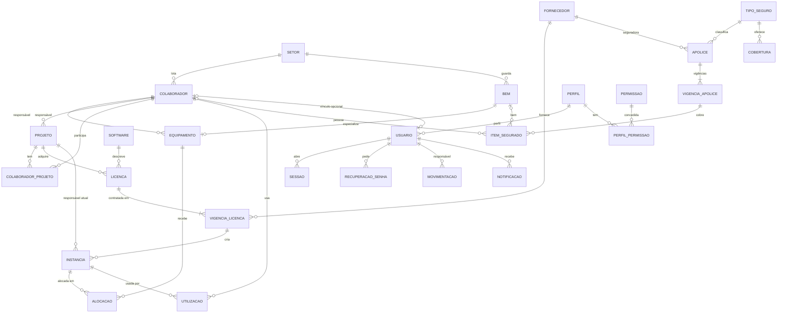

# Banco de dados

Scripts SQL do GESLIC, para **MySQL 8.0.16 ou superior** (necessário para as
restrições `CHECK`). O modelo segue o modelo relacional da ERS 2.4 (seção 3.3),
com as tabelas de sessão e de recuperação de senha da autenticação.

| Arquivo | Conteúdo |
|---|---|
| `schema.sql` | 30 tabelas e 2 gatilhos: as 28 tabelas do modelo da ERS, mais `sessao` e `recuperacao_senha`, já no formato da última migração |
| `seed.sql` | dados de referência: perfis Administrador e Operador, catálogo de permissões e a matriz da RN21 |
| `seed_dev.sql` | dados de exemplo para desenvolvimento e apresentação: setores, colaboradores, equipamentos, projetos, fornecedores, softwares e licenças com instâncias alocadas |
| `migrations/NNN_*.sql` | mudanças incrementais para atualizar bancos já existentes, sem apagar dados |

Os scripts rodam pelo backend (`backend/scripts/`), e não direto no cliente
`mysql`. A razão é que as contas de acesso precisam do hash scrypt da senha,
que o SQL puro não gera.

## Comandos

Com o `backend/.env` configurado, na raiz do projeto:

```bash
npm run db:setup            # banco + tabelas + dados de referência + usuário "admin"
npm run db:setup:exemplos   # o mesmo + dados de exemplo e usuários de teste
npm run db:migrate          # atualiza um banco existente (aplica as migrações pendentes)
npm run db:reset            # APAGA o banco e recria tudo (aceita -- --exemplos)
npm run admin:redefinir     # aplica a senha de ADMIN_SENHA à conta "admin"
```

- **`db:setup` e `db:setup:exemplos`:** nunca apagam nada. Se o banco de
  `DB_NOME` já tiver tabelas, param e indicam o `db:migrate` ou o `db:reset`.
- **`db:migrate`:** aplica só o que falta e pode rodar quantas vezes for
  preciso. Se não houver nenhum Administrador ativo, cria a conta `admin`
  (RN27).
- **`db:reset`:** apaga todos os dados e é bloqueado com
  `NODE_ENV=production`.
- **`admin:redefinir`:** é o procedimento do servidor para quando ninguém
  consegue entrar como Administrador (RN27, Apêndice 3 da ERS). Deixa a conta
  ativa, com perfil Administrador, encerra as sessões dela e registra no
  histórico.

## Contas criadas pelos scripts

| Login | Perfil | Senha | Situação | Criada por |
|---|---|---|---|---|
| `admin` | Administrador | `ADMIN_SENHA` do `.env` (desenvolvimento: `geslic123`) | ativa | `db:setup`, `db:migrate` (se não houver Administrador) |
| `ana.ribeiro` | Administrador | `SENHA_USUARIOS_TESTE` (padrão `Geslic2026`) | ativa | `db:setup:exemplos` |
| `carlos.alves` | Operador | `SENHA_USUARIOS_TESTE` (padrão `Geslic2026`) | ativa | `db:setup:exemplos` |

Com `ADMIN_SENHA` vazia, o `admin` recebe uma senha provisória, mostrada uma
única vez no terminal, com troca obrigatória no primeiro acesso. Com
`NODE_ENV=production`, uma `ADMIN_SENHA` fraca (como a de desenvolvimento) é
recusada. Os usuários de teste ficam ligados aos colaboradores de mesmo
e-mail da carga de exemplo.

## Migrações

Cada arquivo `migrations/NNN_descricao.sql` é aplicado uma única vez, em ordem
numérica, e registrado na tabela `schema_migracao` (criada pelos scripts). Na
instalação nova, o `schema.sql` já contém o efeito de todas as migrações, e
o `db:setup` só as registra como aplicadas.

| Migração | O que faz |
|---|---|
| `001_autenticacao.sql` | conta com `situacao` (pendente, ativo, inativo) no lugar de `ativo`, `troca_senha_obrigatoria`, `criada_em`, `senha_alterada_em` e `ultimo_acesso_em`; tabelas `sessao` e `recuperacao_senha`; `permissao.grupo` e `permissao.exclusiva_administrador`; catálogo de permissões e matriz por perfil |
| `002_gatilhos_restauraveis.sql` | recria os gatilhos que tornam o histórico imutável (RN22) com `BEGIN ... END`. Na forma antiga, o MySQL guardava um `;` dentro do corpo, e o arquivo gerado pelo `mysqldump` falhava na restauração |

As duas migrações foram conferidas assim:

- **Banco antigo e banco novo:** um banco no formato anterior, atualizado com
  `db:migrate`, ficou idêntico, tabela a tabela, a um banco criado do zero
  pelo `db:setup`, em estrutura, restrições, gatilhos, dados e permissões.
- **Cópia de um banco real:** a migração aplicada na cópia preservou os dados,
  e o backup da cópia migrada foi restaurado sem erro.

**Para mudar o banco:**

1. Crie `migrations/NNN_descricao.sql` com o próximo número.
2. Aplique a mesma mudança no `schema.sql` (e no `seed.sql`, se for dado de
   referência), para instalações novas.
3. Rode `npm run db:migrate` e `npm test`.

Uma migração com DDL não entra em transação no MySQL. Se falhar no meio, ela
não é registrada: corrija o arquivo e rode `db:migrate` de novo.

## Cópia de segurança

A ERS prevê cópia trimestral só do banco (seção 2.3.2). Com o cliente do
MySQL:

```bash
mysqldump -u root -p --single-transaction --routines --triggers geslic > geslic_AAAA-MM-DD.sql
mysql -u root -p geslic_restaurado < geslic_AAAA-MM-DD.sql
```

Bancos criados antes da migração `002` geram um arquivo que **não restaura**.
Rode `npm run db:migrate` antes de fazer a cópia.

## Tabelas

**Cadastros (RF_B1 a RF_B8)**

| Tabela | Conteúdo |
|---|---|
| `setor`, `colaborador`, `colaborador_projeto` | setores, colaboradores (`ativo` e `data_desligamento`) e participação em projetos |
| `bem`, `equipamento` | bem segurável e sua especialização equipamento (mesma chave: `equipamento.id_equipamento` = `bem.id_bem`) |
| `projeto` | projetos institucionais, com código de 4 dígitos, término previsto e encerramento manual |
| `fornecedor`, `software` | fornecedores e seguradoras (CNPJ único) e softwares |
| `tipo_seguro`, `cobertura` | tipos de seguro e suas coberturas |

**Licenças e apólices (RF_F1 a RF_F11)**

| Tabela | Conteúdo |
|---|---|
| `licenca`, `vigencia_licenca`, `instancia` | licença, cada contratação ou renovação (vigência) e as instâncias de cada vigência |
| `alocacao`, `utilizacao` | instância em equipamento e instância em uso por colaborador, com no máximo um vínculo vigente por instância |
| `apolice`, `vigencia_apolice`, `vigencia_cobertura`, `item_segurado`, `item_cobertura` | apólice, vigências, coberturas contratadas e bens ou pessoas segurados |
| `documento` | metadados e caminho dos PDFs de cada vigência (RN23) |

**Contas, avisos e auditoria (RF_B9, RF_B10, RF_F12, RF_F13)**

| Tabela | Conteúdo |
|---|---|
| `perfil`, `permissao`, `perfil_permissao` | perfis, catálogo de permissões e a matriz (RN21) |
| `usuario` | conta de acesso, separada do colaborador (vínculo opcional e único) |
| `sessao` | sessões abertas: só o SHA-256 do token, validade e encerramento |
| `recuperacao_senha` | pedidos de redefinição: só o SHA-256 do token, validade curta e uso único |
| `preferencia_notificacao`, `notificacao` | antecedências de cada conta e avisos emitidos (RN24) |
| `movimentacao` | histórico imutável de criações, correções, exclusões e movimentações, com a conta responsável |



## Decisões de modelagem

| Tema | Decisão | Motivo |
|---|---|---|
| Nomes mantidos | `equipamento.id_equipamento` (modelo: `id_bem`), `equipamento.tipo`, `colaborador.ativo` e `licenca.nome_software` | o código da RF_B3 já usa esses nomes; `nome_software` sai quando a RF_F1 passar a usar `software` |
| Situação da conta | `usuario.situacao` (pendente, ativo, inativo) no lugar do booleano `ativo` | o autocadastro precisa do estado "aguardando aprovação"; contas não são excluídas, para preservar o histórico (RN27) |
| Conta e colaborador | `usuario.id_colaborador` opcional e único | a ERS separa conta de acesso e cadastro de pessoa: nenhum cria o outro |
| Senhas e tokens | senha só como hash scrypt; tokens de sessão e de recuperação só como SHA-256 | quem lê o banco não consegue entrar nem redefinir senhas |
| Permissões | catálogo por operação (`cadastro.alterar`, `projeto.encerrar`...), com `exclusiva_administrador` | permissões configuráveis (Quadro 7) sem permitir dar ao Operador o que a RN21 reserva ao Administrador |
| Histórico imutável | gatilhos bloqueiam `UPDATE` e `DELETE` em `movimentacao`; os dados de antes e depois são JSON, sem campos de senha, hash, token ou chave | RN22 e RF_F13 |
| Vínculo vigente único | colunas geradas `instancia_vigente` com `UNIQUE` em `alocacao` e `utilizacao` | no máximo uma alocação e uma utilização vigentes por instância (RN09), mantendo o histórico |
| Regras entre tabelas | capacidade da vigência, perpétua sem fim, mesma licença no mesmo destino e cobertura do item ficam na aplicação | não cabem em `CHECK` com segurança no MySQL (quadro 3.3.1) |

## Integridade e convenções

- **Exclusão:** cadastros com vínculos não são excluídos, apenas inativados ou
  encerrados (RN22). A aplicação confere os vínculos antes, e as chaves
  estrangeiras garantem no banco.
- **Transações:** cada operação grava os dados e o evento do histórico na
  mesma transação.
- **Nomes:** tabelas e colunas em português, minúsculas e `snake_case`;
  restrições com prefixo (`uq_`, `ck_`, `fk_`).
- **Consultas:** sempre parametrizadas (`?`), nunca com valores concatenados.
- **Alterou o schema?** Crie uma migração, atualize o `schema.sql` e este
  README.
